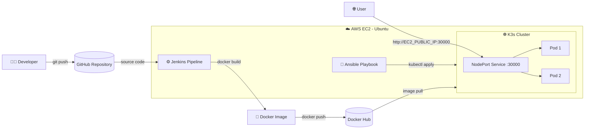

<div align="center">

# 🚀 Next.js DevOps CI/CD Pipeline

**An end-to-end CI/CD pipeline that builds, containerises and deploys a Next.js application using Jenkins, Docker, Kubernetes (K3s) and Ansible on AWS EC2.**


</div>

---

## 📑 Table of Contents

- [Overview](#-overview)
- [Architecture](#-architecture)
- [Tech Stack](#-tech-stack)
- [Repository Structure](#-repository-structure)
- [Pipeline Stages](#-pipeline-stages)
- [Prerequisites](#-prerequisites)
- [Step-by-Step Setup](#-step-by-step-setup)
- [Deploying with Ansible](#-deploying-with-ansible)
- [Verification](#-verification)
- [Kubernetes Manifests Explained](#-kubernetes-manifests-explained)
- [Troubleshooting](#-troubleshooting)
- [Roadmap](#-roadmap)
- [Key Learnings](#-key-learnings)
- [Author](#-author)

---

## 📌 Overview

This project demonstrates a complete DevOps workflow, from a code commit to a running application on Kubernetes:

1. Source code lives on **GitHub**.
2. **Jenkins** builds a **Docker** image using a multi-stage Dockerfile.
3. The image is pushed to **Docker Hub**.
4. **Ansible** applies the Kubernetes manifests to a **K3s** cluster.
5. The app runs with **2 replicas** and is exposed externally through a **NodePort** service.

Everything runs on a single **AWS EC2 (Ubuntu)** instance, which keeps the project easy to reproduce and inexpensive to run.

### Highlights

- ✅ Declarative Jenkins pipeline (`Jenkinsfile`)
- ✅ Multi-stage Docker build (Node 20 Alpine) for a smaller production image
- ✅ Secure registry login using the Jenkins credentials store (no secrets in code)
- ✅ Highly available deployment (2 replicas)
- ✅ Repeatable, hands-off Kubernetes rollout via an Ansible playbook
- ✅ Lightweight orchestration with K3s

---

## 🏗 Architecture



**Flow summary:** `Commit → Jenkins build → Docker image → Docker Hub → Ansible deploy → K3s (2 pods) → NodePort 30000`

---

## 🧰 Tech Stack

| Category | Tool | Purpose |
|---|---|---|
| Source Control | Git, GitHub | Version control and pipeline source |
| CI Server | Jenkins | Automates image build and push |
| Containerisation | Docker | Packages the app (multi-stage build) |
| Registry | Docker Hub | Stores and distributes the image |
| Orchestration | Kubernetes (K3s) | Runs and manages the containers |
| Configuration / IaC | Ansible | Automates the Kubernetes deployment |
| Cloud | AWS EC2 (Ubuntu) | Hosts the entire toolchain |
| Application | Next.js (TypeScript) | Sample web application |

---

## 📂 Repository Structure

```text
nextjs-devops-cicd-pipeline/
├── app/                  # Next.js application source (App Router)
├── public/               # Static assets
├── Dockerfile            # Multi-stage build: deps → builder → runner
├── Jenkinsfile           # Declarative CI pipeline
├── deploy-playbook.yml   # Ansible playbook for Kubernetes deployment
├── deployment.yaml       # Kubernetes Deployment (2 replicas)
├── service.yaml          # Kubernetes NodePort Service (30000)
├── package.json          # Node.js dependencies and scripts
├── next.config.ts        # Next.js configuration
├── tsconfig.json         # TypeScript configuration
└── eslint.config.mjs     # Linting rules
```

---

## 🔄 Pipeline Stages

The `Jenkinsfile` defines three stages:

| # | Stage | What it does |
|---|---|---|
| 1 | **Checkout Code** | Pulls the latest source from GitHub |
| 2 | **Build Docker Image** | Runs `docker build -t <user>/nextjs-devops-app:latest .` |
| 3 | **Push to Docker Hub** | Logs in with stored credentials and pushes the image |

**Environment variables used:**

| Variable | Description |
|---|---|
| `DOCKER_HUB_CREDENTIALS` | Jenkins credentials ID (`docker-hub-credentials`) holding Docker Hub username and password/token |
| `DOCKER_HUB_USER` | Docker Hub username |
| `IMAGE_NAME` | Image name published to Docker Hub (`nextjs-devops-app`) |

> 🔐 The password is passed with `--password-stdin` so it never appears in the process list or build logs.

---

## ✅ Prerequisites

- An **AWS account** with permission to launch EC2 instances
- A **Docker Hub** account (a read/write access token is recommended over a password)
- A **GitHub** account
- Basic familiarity with Linux and the command line

**Recommended EC2 specification**

| Setting | Value |
|---|---|
| OS | Ubuntu 22.04 LTS |
| Instance type | `t3.medium` (2 vCPU, 4 GB RAM) or larger |
| Storage | 20 GB or more |

**Security group inbound rules**

| Port | Protocol | Purpose |
|---|---|---|
| 22 | TCP | SSH access (restrict to your IP) |
| 8080 | TCP | Jenkins web UI |
| 30000 | TCP | Next.js application (NodePort) |

---

## 🛠 Step-by-Step Setup

### 1. Launch and connect to the EC2 instance

```bash
ssh -i your-key.pem ubuntu@<EC2_PUBLIC_IP>
sudo apt update && sudo apt upgrade -y
```

### 2. Install Docker

```bash
sudo apt install -y docker.io
sudo systemctl enable --now docker
```

### 3. Install Jenkins

Follow the official guide for Ubuntu: <https://www.jenkins.io/doc/book/installing/linux/#debianubuntu>

Then allow Jenkins to run Docker commands:

```bash
sudo usermod -aG docker jenkins
sudo systemctl restart jenkins
```

Open `http://<EC2_PUBLIC_IP>:8080`, unlock Jenkins with the initial admin password and install the suggested plugins.

```bash
sudo cat /var/lib/jenkins/secrets/initialAdminPassword
```

### 4. Install K3s

```bash
curl -sfL https://get.k3s.io | sh -
sudo k3s kubectl get nodes

# Make kubectl usable without sudo
mkdir -p ~/.kube
sudo cp /etc/rancher/k3s/k3s.yaml ~/.kube/config
sudo chown $USER:$USER ~/.kube/config
```

### 5. Install Ansible

```bash
sudo apt install -y ansible
ansible --version
```

### 6. Add Docker Hub credentials to Jenkins

1. Go to **Manage Jenkins → Credentials → (global) → Add Credentials**.
2. Kind: **Username with password**.
3. Username: your Docker Hub username. Password: your Docker Hub password or access token.
4. ID: `docker-hub-credentials` (must match the `Jenkinsfile`).

### 7. Create the Jenkins pipeline job

1. **New Item → Pipeline**.
2. Under **Pipeline**, choose **Pipeline script from SCM**.
3. SCM: **Git**, Repository URL: `https://github.com/MuhammadAbbasOfficial/nextjs-devops-cicd-pipeline.git`
4. Branch: `*/main`, Script Path: `Jenkinsfile`.
5. Save and click **Build Now**.

### 8. Update the image reference (if you fork this repo)

Change the Docker Hub username in both files so they point to your own registry:

- `Jenkinsfile` → `DOCKER_HUB_USER`
- `deployment.yaml` → `image: <your-username>/nextjs-devops-app:latest`

---

## 🤖 Deploying with Ansible

After Jenkins has pushed the image, run the playbook from the repository root:

```bash
ansible-playbook deploy-playbook.yml
```

The playbook runs against `localhost` and performs these tasks:

1. `kubectl apply -f deployment.yaml`
2. `kubectl apply -f service.yaml`
3. `kubectl get pods` to verify that the pods are running
4. Prints the pod status in the Ansible output

Because the manifests are applied declaratively, the playbook is **idempotent**: running it again safely reconciles the cluster with the desired state.

---

## 🔍 Verification

```bash
# Pods should show 2 replicas in Running state
kubectl get pods -l app=nextjs-app

# Service should expose port 3000 on NodePort 30000
kubectl get svc nextjs-service

# Local check from the EC2 instance
curl -I http://localhost:30000
```

Open the application in your browser:

```text
http://<EC2_PUBLIC_IP>:30000
```

---

## ☸️ Kubernetes Manifests Explained

### `deployment.yaml`

| Field | Value | Meaning |
|---|---|---|
| `kind` | `Deployment` | Manages the pod lifecycle and rolling updates |
| `replicas` | `2` | Two pods run at all times for availability |
| `image` | `<user>/nextjs-devops-app:latest` | Image pulled from Docker Hub |
| `containerPort` | `3000` | Port the Next.js server listens on |

### `service.yaml`

| Field | Value | Meaning |
|---|---|---|
| `type` | `NodePort` | Exposes the app outside the cluster |
| `port` / `targetPort` | `3000` | Service port forwarding to the container port |
| `nodePort` | `30000` | External port on the EC2 instance |

### `Dockerfile` (multi-stage)

| Stage | Base image | Role |
|---|---|---|
| `deps` | `node:20-alpine` | Installs dependencies with `npm ci` |
| `builder` | `node:20-alpine` | Runs `npm run build` |
| `runner` | `node:20-alpine` | Final runtime image that runs `npm start` on port 3000 |

---

## 🩺 Troubleshooting

| Problem | Likely cause | Fix |
|---|---|---|
| `permission denied` on `docker build` in Jenkins | Jenkins user is not in the `docker` group | `sudo usermod -aG docker jenkins && sudo systemctl restart jenkins` |
| `unauthorized` on `docker push` | Wrong credentials or credentials ID | Verify the `docker-hub-credentials` ID and use a valid token |
| Pods stuck in `ImagePullBackOff` | Image name or tag wrong, or repository is private | Confirm the image exists on Docker Hub and that `deployment.yaml` uses the same name |
| `kubectl` cannot connect | Kubeconfig not set | Copy `/etc/rancher/k3s/k3s.yaml` to `~/.kube/config` or set `KUBECONFIG` |
| App not reachable in browser | Port 30000 blocked | Add an inbound rule for TCP 30000 in the EC2 security group |
| Pods use an old image after a new build | `latest` tag is cached | Run `kubectl rollout restart deployment/nextjs-app` |

---

## 🗺 Roadmap

Planned improvements to make this pipeline more production-ready:

- [ ] Tag images with the build number (`:${BUILD_NUMBER}`) instead of only `latest`
- [ ] Trigger builds automatically with GitHub webhooks
- [ ] Add lint and test stages before the image build
- [ ] Add a Jenkins stage that runs the Ansible deployment automatically (full CD)
- [ ] Add readiness and liveness probes plus resource requests/limits
- [ ] Scan images for vulnerabilities (Trivy)
- [ ] Add an Ingress with TLS (Traefik with Let's Encrypt)
- [ ] Add monitoring with Prometheus and Grafana
- [ ] Provision the EC2 instance with Terraform

---

## 📚 Key Learnings

- Building a pipeline that connects source control, CI, registry and orchestration
- Writing efficient multi-stage Dockerfiles
- Managing secrets safely with the Jenkins credentials store
- Running and exposing workloads on Kubernetes with Deployments and Services
- Automating deployments with Ansible instead of manual `kubectl` commands
- Configuring AWS EC2 networking and security groups

---

## 👤 Author

**Muhammad Abbas**
Android Developer (5+ years) transitioning into DevOps

- GitHub: [@MuhammadAbbasOfficial](https://github.com/MuhammadAbbasOfficial)
- Email: mabbas786official@gmail.com
- Location: Mardan, Pakistan

---

<div align="center">

⭐ If you found this project helpful, please consider giving it a star.

</div>
